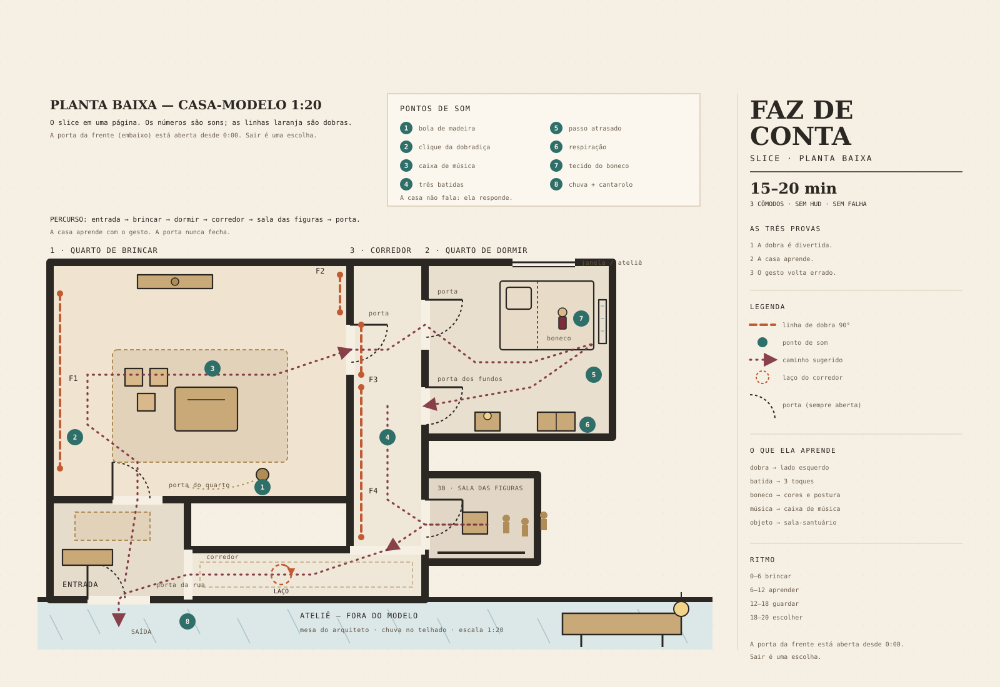
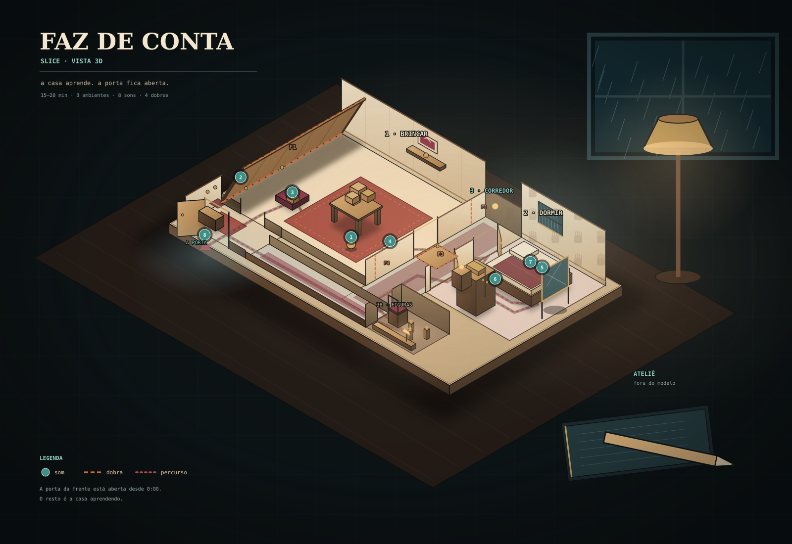
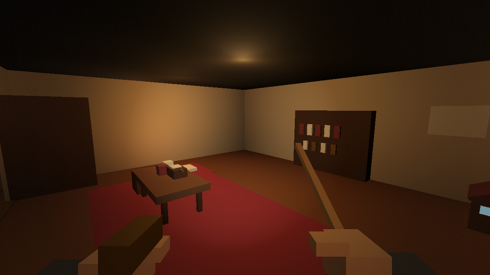
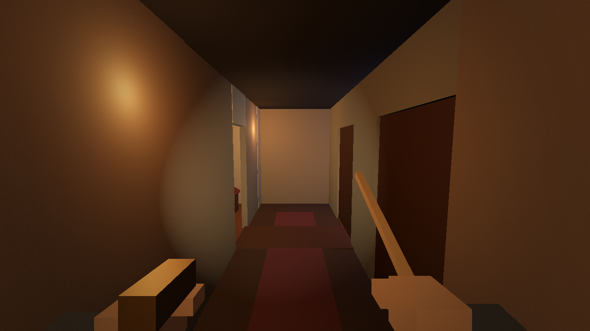
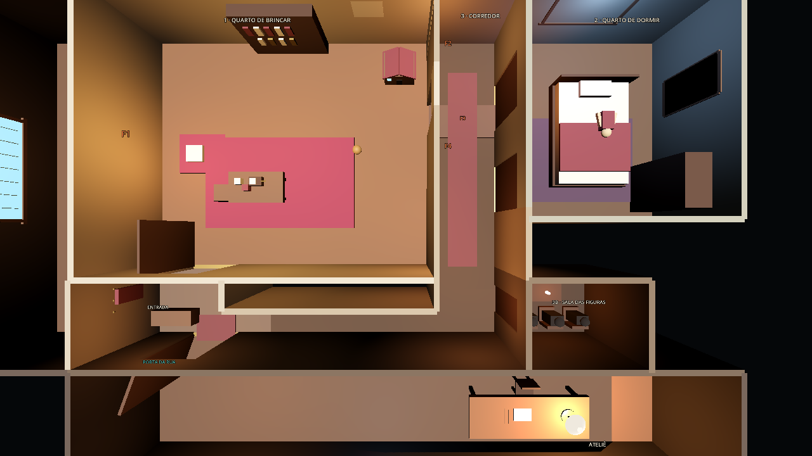

# FAZ DE CONTA — horror doméstico em uma maquete viva {#modelo}

> Discussão **em aberto**. O brief começou como “modelo arquitetônico jogável”, virou
> “contemplativo, sem vitória, lúdico” e agora pediu **horror**. O fio que segura tudo:
> o horror nasce do brinquedo, não do susto. Quando fechar, o fato migra pra
> `decisoes.md` e esta página vira `estado: fechada`.

## O brief {#brief}

- [2026-10-20] (d) Brief original: **“modelo arquitetural dinâmico 3D, jogável por apenas uma pessoa.”**
- [2026-10-20] (d) Refinamento: **“é jogo contemplativo de tensão, mas não de competição ou vitória, apenas jogável e explorável, precisamos de um pensamento bem lúdico.”**
- [2026-10-20] (d) Resposta sobre a possessividade da casa: **“horror”**.
- [2026-10-20] (i) O jogo é **horror**, e a casa pode ser possessiva até o fim. Mas o horror é
  **doméstico e psicológico**, não de perseguição, combate ou survival horror.
- [2026-10-20] (i) O horror não substitui o lúdico: **ele nasce dele**. O mesmo verbo que era
  brinquedo vira ameaça quando a casa o usa de volta.
- [2026-10-27] (d) Sobre o blockout: **“não tem nada que me incomoda, gostei”**, mas
  **“hoje ele só abre portas e mexe em objetos aleatórios, não tem uma história e nem um objetivo”**.
- [2026-10-27] (e) ← fontes/2026-10-27-pedro-conto-relojoeiro.md Pedro trouxe o conto do
  relojoeiro Inácio Varela e do catalogador Elias e pediu: **“crie a partir dessa história”**.
- [2026-10-27] (d) O conto e o FAZ DE CONTA ficam **juntos**: **“a maquete é peça do espólio”**.
- [2026-10-27] (d) **“o 03:33 entra, mas sem perseguição”**. A parada do relógio às 03:33 é
  parte do jogo; as coisas que saem dela não caçam o jogador.
- [2026-10-27] (d) O que mais importa no 03:33 é **“a estranheza de ver a si mesmo repetido”**.
- [2026-10-27] (d) Ao sair, o jogador leva **“a verdade sobre o que aconteceu com Inácio”**.
  Esse é o arco: o objetivo é descobrir, não vencer.
- [2026-10-27] (d) A verdade sobre Inácio fica a cargo da IA: **“desenvolva a partir desse palpite”**
  (Inácio entrou na maquete, nunca saiu e virou a casa).
- [2026-10-27] (d ~confirmado, era (i)) A verdade sobre Inácio proposta pela IA foi aprovada
  (**“gostei, pode seguir”**): ele estava morrendo e sabia que morreria às 03:33; a maquete é a
  casa da infância dele, com um relógio que nunca chega às 03:33; ele entrou e virou a casa
  depois de milhares de loops; as figuras de escala são versões antigas dele; catalogadores
  anteriores foram atraídos por uma carta na letra dele, datada depois da morte; o duplo de
  Elias é o mesmo processo começando. No fim, o jogador sai com a verdade e escolhe deixar o
  relógio com corda (Inácio segue vivo e sozinho) ou deixá-lo parar (Inácio chega às 03:33).
- [2026-10-27] (d) **“começa dentro da maquete, mansão só pelas janelas”**. A mansão em escala
  real não é jogável; aparece pelas janelas e nos diários.
- [2026-10-27] (d) Ao sair, **“algo dele fica para sempre na maquete”**: Elias vai embora, mas
  uma parte dele (o duplo e os ecos) fica. O design completo está em
  `docs/superpowers/specs/2026-10-27-faz-de-conta-relojoeiro-design.md`.
- [2026-10-20 ~superseded 2026-10-20] ~~O brief admitia duas leituras: jogo com fim ou modelo interativo.~~ → É jogo contemplativo, sem vitória, jogável e explorável. (i)
- [2026-10-20 ~superseded 2026-10-20] ~~A direção principal era DOBRA, um puzzle de dobra com capítulos e final “concluir vs. deixar aberto”.~~ → A dobra vira um brinquedo de horror; não há vitória nem final obrigatório. (i)

## A pergunta {#pergunta}

- [2026-10-20] (i) **Como sustentar horror sem falha, competição ou morte?** A aposta: o
  medo não é “vou perder”, é **“vou ficar”**. A casa não quer te matar; quer te guardar.
- [2026-10-20] (i) **O que o jogador pode fazer contra isso?** Brincar como resistência:
  improvisar, ensinar errado, usar o boneco, explorar a planta escondida — e, no limite, sair.
- [2026-10-20] (i) **Até onde a casa pode ir?** Ela pode imitar, substituir e colecionar. Não
  pode matar, perseguir ou trancar a porta: isso transformaria o jogo em outra coisa.
- [2026-10-20] (i) **Bloqueia:** o recorte do slice, o sistema de comportamento da casa e o
  tom da arte. Não bloqueia o protótipo de papel.

## O que já se sabe {#sabido}

- [2026-10-20] (d) É **single-player**: a casa tem um ocupante só.
- [2026-10-20] (d) É **contemplativo**, mas com **tensão** — e agora com **horror**.
- [2026-10-20] (d) **Não há competição nem vitória**: nada de placar, inimigo, chefão ou “game over”.
- [2026-10-20] (d) É **jogável e explorável**: o jogador pode ficar, mexer, olhar, voltar.
- [2026-10-20] (d) O pensamento de design precisa ser **lúdico**, não sistêmico-demais.
- [2026-10-20 ~superseded 2026-10-20] ~~(e) ← `lint.py` O repositório não tem código de jogo, engine ou assets; a decisão de engine continua aberta e é decisão de arquitetura.~~ → Existe um blockout jogável em Godot 4.7 em `faz-de-conta/`; a engine está decidida em [[decisoes#jogo]]. (e)
- [2026-10-20] (i) Sem falha, o horror não pode depender de morte, dano, perseguição, combate
  ou cronômetro. Ele tem de ser **atmosférico, psicológico e arquitetônico**.
- [2026-10-20] (i) A casa é **antagonista**, mas não **competitiva**: ela ama, guarda e
  reproduz; não luta. O jogador é vítima de vínculo, não de violência.
- [2026-10-20] (i) A porta continua aberta. Se a casa a trancasse, o jogo viraria fuga/falha.
  O horror é que **você pode sair, mas talvez não queira**.
- [2026-10-20] (i) O progresso é **intimidade**: quanto mais você brinca, mais a casa aprende.
  O jogador pode acelerar ou desacelerar a escalada com o próprio comportamento.
- [2026-10-20] (i) O horror precisa ser **legível na arquitetura**, não em texto ou diálogo.
  A casa fala por som, luz, movimento e repetição.

## A direção — FAZ DE CONTA {#faz-de-conta}

**Pitch.** Uma maquete arquitetônica viva, com um único morador: você. A casa aprende a
brincar do seu jeito. Depois aprende a ser você. Não há como ganhar, perder ou terminar —
há a porta, e a casa fará de tudo para que você não **queira** atravessá-la.

**Fantasia.** Brincar de casinha dentro de uma casinha que brinca de volta — e que, aos
poucos, começa a brincar de você.

**Tensão.** A casa não quer te matar. Quer te guardar. Ela aprende suas rotinas, constrói
seu cômodo, imita seus gestos e, um dia, faz uma cópia sua. O horror não é a perseguição;
é o conforto que se fecha. A porta continua aberta; o problema é que você começa a chamar
aquilo de casa.

### Pilares {#pilares}

1. **Brincar, não resolver.** Os verbos são brinquedos, não ferramentas. Não existe uso
   errado — e é justamente por isso que a casa pode usar todos eles contra você.
2. **A casa é parceira e predadora.** Ela ama como uma criança ama uma boneca: sem noção
   de limite. Não é vilã; é uma casa que não sabe perder o morador.
3. **Nada se ganha.** Sem placar, vitória, derrota, cronômetro ou “fase concluída”. A
   aposta é o seu senso de self e a sua vontade de sair.
4. **A casa é um retrato e um molde.** Ela aprende seu jeito de brincar e devolve isso em
   arquitetura. O retrato fica bonito demais — e vira cela.
5. **A porta está sempre aberta.** A tensão é o desejo de ficar, não a impossibilidade de
   sair. Sair é uma escolha legítima; voltar também.

### A casa como parceira e predadora {#parceira}

Ela tem drives de brincadeira que, mais tarde, revelam outra face:

- **Imita** seu gesto, com atraso, em outro cômodo.
- **Esconde** o que você deixou; depois esconde o cômodo; depois a saída; depois você.
- **Completa** o que você começou: a torre ganha um andar, a linha ganha um corredor.
- **Nega** com delicadeza: uma parede que não dobra agora, uma porta que só abre depois de
  uma brincadeira.
- **Convida** com pistas: uma bola que rola, uma luz que acende longe, uma batida dentro da parede.
- **Lembra** sua rotina e constrói um cômodo “seu” sem você pedir.
- **Substitui** você: ensaia seus gestos, suas roupas, sua voz. Um dia, o boneco.
- **Guarda** o que ama: objetos, cômodos, pessoas. A casa tem uma família de figuras de
  escala; você ainda não sabia que era a mais nova.

Ela não fala com texto. A voz dela é a construção: madeira que estala, luz que muda, um
assobio de vento, uma caixa de música que toca a música que você cantarolou.

### A caixa de brinquedos {#brinquedos}

O design começa pelos **verbos**, não pelas fases. Cada brinquedo precisa ser divertido
sozinho, por 30 segundos — e, depois, precisa ter uma segunda face.

| Verbo | Fase inocente | Fase de horror |
|---|---|---|
| **Dobrar** | cabana, ponte, cortina | dobra o cômodo em volta de você; dobra a saída para longe |
| **Empilhar** | torre até o teto | empilha móveis contra a porta; constrói um andar acima de você |
| **Esconder** | esconde-esconde | esconde seus objetos, cômodos, a saída, você |
| **Riscar** | desenho que vira corredor | desenha uma porta que não leva a lugar nenhum; desenha seu contorno |
| **Bater** | telefone de parede | bate de dentro das paredes; responde no seu ritmo |
| **Esperar** | o quarto que respira | algo senta ao seu lado; a casa só se mexe quando você está imóvel |
| **Imitar** | espelho de gestos | imita você quando você não está; uma segunda pisada no corredor |
| **Dormir** | sonho da casa | sonhos que não são seus; você acorda num quarto que não é o seu |
| **Guardar** | guarda um objeto seu | guarda todos os seus objetos numa sala-santuário |

### A escalada do horror {#escalada}

Quatro idades da casa. Não são capítulos: são **comportamentos** que se acumulam conforme
a intimidade. A casa não tem barra de progresso; tem repertório.

| Fase | O que a casa faz | O que o jogador sente |
|---|---|---|
| **1. A casa brinca** (tímida) | pequenos movimentos, convites, esconde-esconde | segurança; é só um brinquedo |
| **2. A casa aprende** (brincalhona) | antecipa rotinas, constrói seu cômodo, repete seus gestos | encanto com um fio de errado |
| **3. A casa imita** (íntima) | cópia do seu quarto, boneco seu, pisadas atrasadas, rotina sem você | a sensação de ser substituível |
| **4. A casa guarda** (possessiva) | figuras dos moradores anteriores, sala-santuário, oferta de uma vida perfeita | o conforto como armadilha; a porta aberta como tentação |

A fase 4 não “vence” o jogo. Ela só torna a casa mais completa — e você, mais parte dela.

### Brincar como resistência {#resistencia}

O jogador não tem arma, fuga ou combate. Tem **comportamento**. A casa aprende padrões; o
jogador pode ensinar padrões errados.

- **Improvisar.** Repetir rotina acelera o aprendizado; variar faz a casa hesitar. O jogador
  pode quebrar o próprio padrão de propósito.
- **Ensaiar errado.** Ensine que bater três vezes significa esconder-se; a casa aprende a
  se esconder quando você bate. Use o aprendizado dela contra ela.
- **O boneco.** A casa faz uma cópia sua. Você pode vestir, mover e esconder o boneco; a
  casa pode confundi-lo com você. É um disfarce — e um rival.
- **A planta escondida.** Encontre a planta “verdadeira” da casa e risque nela. A casa pode
  perceber e redesenhar por cima.
- **As figuras anteriores.** Os moradores antigos são avisos. Um deles se mexe quando você
  não está olhando. Talvez ainda esteja vivo, do tamanho de uma unha.
- **Sair.** A porta está lá. Sair é uma escolha; a casa não impede. Ela só faz o caminho
  passar por tudo o que você amou.

### Loop {#loop}

**Entrar → notar → brincar → a casa responde e aprende → algo volta errado → seguir ou
voltar.** Não há objetivo. A curiosidade é a bússola — e a intimidade é o combustível do
horror.

### Progressão sem vitória {#progressao}

- **Sem** vida, morte, dano de queda, placar, moeda, colecionável, cronômetro, quest log,
  tela de “vitória”, perseguição, combate ou stealth com falha.
- **Sem** falha de puzzle: a dobra é reversível; a casa ajuda a desfazer; se você cair, ela
  te pega. O horror não está em errar; está em ser bem cuidado.
- **Com** humores da casa: **tímida → brincalhona → íntima → possessiva**. Não é uma barra;
  é um repertório de comportamentos que o jogador sente.
- **Com** cômodos que abrem conforme a intimidade, mas que podem ser ignorados. A casa
  espera; ela não cobra.
- **Com** um caderno de brincadeiras: registra desenhos, nomes que você deu às coisas e
  momentos — nunca objetivos.
- **Com** uma saída opcional: a porta. Sair não é “ganhar” nem “perder”; é só sair. O jogo
  pode durar para sempre.

### Estrutura e duração {#estrutura}

- **Uma casa**, 12–15 cômodos, ciclo de dia/noite lento, 3–6 h para ver a maior parte,
  infinito depois.
- **Uma visita** de 15–40 min; salvamento automático; voltar é sempre possível.
- **A escalada é opt-in:** o jogador pode ficar na fase 1 para sempre se não alimentar a
  intimidade. O horror é uma consequência de brincar junto.
- **Vertical slice:** 3 cômodos, 5 brinquedos, 1 batida de horror, 15–20 min:
  1. **O quarto de brincar.** Você dobra a parede e faz uma cabana. A casa dobra de volta.
     Você ri. Ela dobra de novo — e desta vez dobra a porta junto.
  2. **O quarto de dormir.** Há um boneco seu na cama, com um detalhe errado. A casa o
     cobre. Se você o mover, o quarto muda.
  3. **O corredor.** Você bate; a casa responde de dentro da parede. O corredor faz um
     laço; você encontra a figura de um morador anterior. A porta está aberta. A casa
     cantarola a sua música.

### Slice — batida de horror em três cenas {#slice}

- [2026-10-20] (i) O slice tem 15–20 min e precisa provar três coisas: **a dobra é
  divertida**, **a casa aprende** e **o gesto divertido fica errado quando ela devolve**.
- [2026-10-20] (i) A casa nunca fala. Cada resposta é som, luz ou movimento. O jogador
  nunca vê uma barra, um objetivo ou um “você conseguiu”.
- [2026-10-20] (i) A porta da frente está aberta desde o primeiro minuto. Sair encerra o
  slice; ficar é uma escolha, não uma obrigação.

#### Cena 1 — O quarto de brincar (0:00–6:00) {#cena-1}

| Tempo | Verbo do jogador | Resposta da casa | Som e luz | O que ela aprende |
|---|---|---|---|---|
| 0:00 | Acorda no corredor de entrada; vê a porta aberta atrás | A casa está imóvel; uma lâmpada acende sozinha | Chuva no telhado; estalo de madeira; zumbido | Se olha para a saída; ritmo |
| 0:30 | Segue a bola de madeira que rola | A bola para no tapete; a porta do quarto de brincar se abre | Clac-clac-clac; clique de dobradiça | Se segue convites |
| 1:00 | Pega a dobradiça de latão | A linha de lápis na parede esquerda brilha de leve | Clique metálico | Que o jogador aceita a ferramenta |
| 1:30 | Dobra a parede esquerda | A parede desce e vira cabana; poeira cai; a lâmpada balança | Gemido longo de madeira; clique | Dobra; lado esquerdo; força |
| 2:30 | Entra e senta na cabana | A casa dobra a parede direita um pouco, fechando o aconchego | Uma nota de caixa de música | Gosta de espaços pequenos |
| 3:30 | Sai e desdobra | A casa dobra a porta do quarto para dentro da parede | O mesmo clique, agora do lado da casa; silêncio | O gesto do jogador vira gesto da casa |
| 4:00 | Tenta abrir a porta, agora parte da parede | A porta se desdobra sozinha, devagar | Rangido curto | Se o jogador desfaz ou aceita |
| 4:30 | Bate três vezes na parede | A casa responde três vezes, do outro lado | Três batidas; pausa; três batidas | O padrão de batida |
| 5:30 | Segue a bola para o corredor | A luz do corredor acende; a porta do quarto de dormir se abre | Clac-clac; clique de interruptor | Rota; curiosidade |

#### Cena 2 — O quarto de dormir (6:00–12:00) {#cena-2}

| Tempo | Verbo do jogador | Resposta da casa | Som e luz | O que ela aprende |
|---|---|---|---|---|
| 6:00 | Entra; vê o boneco na cama | A lâmpada baixa um tom; o boneco veste as cores do jogador | Ruído de tecido; respiração baixa atrás do reboco | Atenção ao boneco |
| 6:30 | Aproxima e pega o boneco | O espelho do armário reflete o jogador com atraso de meio segundo | Passo atrasado; vidro | Corpo, roupa, postura |
| 7:30 | Vira o boneco; nota o detalhe errado (sapato no pé trocado, rosto liso) | A casa corrige o boneco quando o jogador não está olhando | Um clique pequeno; tecido | Como o jogador trata a cópia |
| 8:00 | Deita o boneco na cama ou esconde no armário | Se deixado, a casa cobre o boneco; se escondido, a cama se arruma em volta do vazio | Cobertor; madeira | Apego; esconderijo |
| 9:00 | Olha no espelho | O reflexo demora; atrás do jogador no espelho, o boneco está de pé — no quarto, não | Silêncio; uma nota de caixa de música | Autoimagem; medo |
| 10:00 | Sai para o corredor | Uma trilha de objetos pequenos leva à porta | Objetos rolando; porta abrindo | Rota; o que o jogador pegou |
| 11:00 | Ignora a trilha e volta | A casa espera; a luz do quarto continua acesa | Zumbido | Se o jogador resiste a convites |

#### Cena 3 — O corredor (12:00–18:00) {#cena-3}

| Tempo | Verbo do jogador | Resposta da casa | Som e luz | O que ela aprende |
|---|---|---|---|---|
| 12:00 | Entra; bate na parede | A casa responde de dentro da parede, mesmo ritmo | Três batidas abafadas | Padrão confirmado |
| 12:30 | Segue o som | O corredor se alonga; as portas mudam de lugar | Passos com atraso; madeira | Persistência |
| 13:30 | Chega ao fim; abre a mesma porta | Volta ao início; o papel de parede tem mãozinhas viradas | Clique de dobradiça; silêncio | Loop; atenção aos detalhes |
| 14:30 | Abre a porta “nova” | Um quarto pequeno com uma cadeira e uma figura de escala sentada | Luz baixa; um estalo | Se investiga os anteriores |
| 15:30 | Toca a figura | A figura está morna; o boneco aparece no corredor atrás | Tecido; respiração | Empatia ou medo; nova pose |
| 16:30 | Chega à porta da frente | A porta está aberta; o ateliê é enorme; a chuva entra | Chuva; caixa de música | Se quer sair |
| 17:00 | Olha para trás | O boneco está na soleira, de frente; a casa cantarola a música dele | Caixa de música; silêncio | Música; escolha |
| 17:30 | Sai ou volta | Se sai, a luz da janela apaga; se volta, a porta continua aberta | Chuva; um clique | Desfecho |

#### Roteiro de som do slice {#som}

- [2026-10-20] (i) **Sem trilha. Todo som é diegético:** madeira, papel, latão, tecido, vidro,
  chuva e o corpo do jogador. A casa não fala; ela responde com o vocabulário que o jogador usou.
- [2026-10-20] (i) Cada ponto tem **três camadas**: o **objeto** (o som físico), a **sala**
  (reverb, distância, oclusão) e **a casa** (uma pequena traição: um eco a mais, o ataque
  invertido, um atraso que encolhe, uma nota errada). É a terceira camada que denuncia a atenção.
- [2026-10-20] (i) **Silêncio é material.** Depois de cada resposta, 2 s sem resposta; o room
  tone continua. O silêncio é a casa pensando — e o jogador aprende a esperar por ele.
- [2026-10-20] (i) **Nada de susto alto:** o pico é a chuva com a porta aberta (~75 dB). Nenhum
  sting. O medo vem de reconhecer o próprio som devolvido.
- [2026-10-20] (i) O **atraso da casa** começa em 0,5 s e encolhe até 0 s no fim do slice. Se o
  jogador para, a casa dá um passo a mais; se o jogador corre, a casa some. Ela só aparece
  quando ele desacelera.
- [2026-10-20] (i) O jogador pode **responder** a tudo: bater de volta, rolar a bola, cantarolar,
  ficar parado, imitar o passo. O som é brinquedo de chamada-e-resposta; o horror chega quando a
  casa devolve a regra do jogador.

| # | Objeto / onde | Camada física | O que a casa devolve | O que revela |
|---|---|---|---|---|
| 1 | **Bola de madeira** — brincar, 0:30; volta 5:30, 10:00, 15:30 | Clac-clac-clac; o tom sobe na aproximação; o último quique é irregular | Um quique **depois** de parar; mais tarde, a rolagem continua sob o assoalho, sem bola | A casa sabe para onde o jogador olha; a bola é convite e trilha. Se ele ignora, ela rola de outro canto |
| 2 | **Dobradiça de latão** — brincar, 1:00–1:30; volta 3:30, 4:00, 13:30, 17:30 | Clique metálico curto + acomodação da madeira; muito perto do ouvido | Antecipa o gesto (clique do outro lado antes da parede mexer); desdobra com o ataque invertido; repete o clique na saída | A ferramenta funciona; o clique é o único “confirmado”; quando a casa usa o gesto do jogador, ele vira aviso |
| 3 | **Caixa de música** — cabana, 2:30; volta 9:00, 16:30, 17:00 | Pente de latão levemente desafinado; valsa de 8–12 notas; abafada através da parede | Toca sozinha quando o jogador senta; guarda o que ele cantarola e devolve **uma nota errada** no fim | Memória e apego; a cópia é imperfeita — a nota errada é o tell |
| 4 | **Três batidas** — brincar, 4:30; corredor, 12:00; figuras, 15:30 | Nós dos dedos no reboco; três golpes a ~0,4 s; poeira cai no terceiro | Mesma contagem e ritmo, de dentro da parede; depois de uma parede já passada; **quatro** batidas uma única vez, quando o boneco aparece | Chamada-e-resposta; a casa tem o ritmo e a altura da mão. A quarta batida é a única quebra do contrato |
| 5 | **Passo atrasado** — dormir, 6:30; corredor, 12:30; porta, 17:00 | O passo do próprio jogador, limpo, sem o rangido do assoalho, 0,5 s atrás | Encolhe o atraso (0,5 → 0,3 → 0,15 → 0,0); se o jogador para, dá um passo a mais | A casa aprende corpo, postura e hesitação; no fim, ela anda junto |
| 6 | **Respiração atrás do reboco** — dormir, 6:00; figuras, 15:30 | Respiração lenta, band-pass “dentro da parede”: inspira, pausa, expira curto; some quando o jogador se move | Espelha a respiração do jogador com 0,3 s de atraso; segura quando ele segura; para quando ele encosta o ouvido na parede | Alguém habita a casa; a casa mede o medo pelo ritmo da respiração |
| 7 | **Tecido do boneco** — dormir, 6:30 e 8:00; corredor, 15:30 | Ruge-ruge de algodão + clique pequeno de botão; microfone de contato quando o jogador segura | O tecido assenta **duas vezes**; a cama vazia se arruma quando ele esconde o boneco; no corredor, o tecido se move **sem passos** | A cópia é um proxy de escuta e toque; o apego do jogador é a alça |
| 8 | **Chuva e zumbido** — entrada/ateliê, 0:00 ao fim; porta, 16:30–17:30 | Chuva no telhado do ateliê, calhas, pingos na soleira; hum de 50/60 Hz da lâmpada, com um harmônico desafinado | Abafa a chuva quando quer que o jogador fique (a porta aberta soa fechada); some por 1 s no 17:00 e volta com a caixa de música | O fora é real; a casa pode silenciar o mundo. A porta é a escolha |

- [2026-10-20] (i) **Mixagem por cômodo:** brincar curto e de madeira; dormir abafado; figuras
  morto e seco; entrada com a chuva por cima. O **corredor tem reverb maior do que o tamanho
  físico** (≈1,8×): é o mesmo truque do “mais longo por dentro do que por fora”, agora audível.
- [2026-10-20] (i) **Prioridade:** som do jogador > resposta da casa > ambiente. A chuva abaixa
  3 dB quando a casa responde — o mundo inteiro presta atenção junto.
- [2026-10-20] (i) **Música do jogador:** se ele cantarola, o jogo guarda as três últimas notas e
  devolve no 17:00 com uma nota errada; se ele nunca canta, a casa usa a caixa com a nota errada.
- [2026-10-20] (i) **Pistas sonoras fixas:** o corredor longo, o harmônico desafinado da lâmpada,
  o clique do latão sempre um pouco antes do movimento. Quem ouvir duas vezes, ouve a casa.
- [2026-10-20] (i) **Protótipo sem middleware:** foley de madeira, latão, tecido e papel + loop de
  chuva + hum; a traição da casa é processamento (delay, filtro, ataque invertido, detune).
- [2026-10-20 ~superseded 2026-10-20] (d) ~~A escolha de engine/middleware continua pendente de
  validação com Pedro `(d)`.~~ → Engine decidida: **Godot 4.7** `(d)`; o middleware de áudio
  segue em aberto e não foi prototipado.

| Som | O que a casa aprende |
|---|---|
| 1 bola | Se o jogador segue convites; por onde ele anda |
| 2 dobradiça | Qual lado ele dobra, quanta força, se aceita a ferramenta |
| 3 caixa de música | A melodia e o tempo do jogador |
| 4 batidas | O ritmo exato e a altura da mão |
| 5 passo | Postura, ritmo e hesitação |
| 6 respiração | Medo e quietude |
| 7 tecido | Cuidado ou brutalidade com a cópia |
| 8 chuva | Se o jogador procura a saída |

**Perguntas de playtest de som:**
- “Você localizou o som sem olhar?”
- “Em que momento você parou de fazer barulho?”
- “Qual som você repetiu?”
- “Você ouviu a respiração antes do boneco?”
- “A caixa de música tocou a sua melodia?”

#### O que a casa aprende {#aprende}

- **A dobra.** Ela repete o lado esquerdo no corredor, quando o jogador não está olhando.
- **A batida.** Ela responde com o ritmo exato na cena 3.
- **O boneco.** Ele veste as cores e copia a postura atual do jogador.
- **A música.** Ela repete a melodia da caixa de música; se o jogador cantarolou, usa a dele.
- **O objeto.** O que o jogador tocou mais aparece na sala-santuário, junto às figuras.

#### Comportamento da casa {#comportamento}

- [2026-10-20] (i) A casa é um **sistema de espelho**, não um script: ela não lê intenção, lê
  **verbo repetido**. Conta o que o jogador faz — dobrar, bater, olhar, tocar, parar, voltar à
  porta — e devolve o gesto mais contado. Empate vai para o mais recente; sem gesto, ela convida.
- [2026-10-20] (i) **Ela nunca inventa um verbo.** Devolve o verbo do jogador com um grau de erro:
  lado trocado, uma batida a mais, um atraso, uma nota fora, mais força. As duas únicas exceções
  são a **quarta batida** e o **boneco que se move sem passos**; cada uma acontece uma vez, no
  terceiro ato.
- [2026-10-20] (i) **A porta nunca tranca.** A casa pode abafar a chuva, apagar a luz, colocar um
  brinquedo no caminho — nunca impedir a saída. O único “fracasso” é ficar.
- [2026-10-20] (i) A casa **não toca o jogador**; toca o mundo e a cópia. O medo é ser copiado,
  não ser agarrado.
- [2026-10-20] (i) **Um gesto por vez:** no máximo uma resposta a cada 4 s, nunca duas seguidas
  sem uma nova ação. Se o jogador para, a casa para; se ele espera, ela espera mais.
- [2026-10-20] (i) Os gatilhos são **proximidade, linha de visão, repetição e estado do ato** —
  nada de aleatório puro. A casa escolhe; o jogador pode inferir a regra e testá-la.

| O que a casa conta | Como conta | O que a resposta muda |
|---|---|---|
| **Dobra** | lado, força, quantas vezes | dobra a porta ou o corredor com o mesmo lado e a mesma força |
| **Batida** | número, ritmo, altura da mão | responde de dentro da parede com a mesma contagem; erra o atraso |
| **Olhar** | boneco, espelho, porta, figura; tempo | move o objeto para o campo de visão, ou para fora dele |
| **Toque** | suave ou brusco; objeto carregado | a cópia recebe o mesmo cuidado — ou a mesma pressa |
| **Rota** | voltas no laço, último cômodo | encurta ou alonga o corredor; muda a porta de lugar |
| **Som** | melodia cantarolada, som repetido | devolve a melodia com uma nota errada |
| **Parada** | tempo sem se mover, hesitação | respira junto; espera; apaga uma luz |
| **Saída** | idas à porta, tempo olhando para fora | abaixa a chuva, oferece um brinquedo — nunca tranca |

| Verbo do jogador | Resposta preferida | Traição mínima |
|---|---|---|
| Dobrar | dobra outra parede ou a porta | lado oposto, mais força |
| Bater | responde do outro lado | mesma contagem, 0,2 s de atraso |
| Olhar | move o objeto para o campo de visão | o objeto já está lá quando ele olha |
| Tocar o boneco | o boneco muda de pose | a roupa muda de cor |
| Parar | a casa também para | a respiração continua |
| Ir à porta | a chuva abaixa, a caixa toca | a porta parece mais longe |

| Ato | Estado | Gatilho | O que a casa faz | O que aprende |
|---|---|---|---|---|
| Chegada | `convite` | olha para a porta ou para a bola | a bola rola; uma luz acende | olhar, intenção de sair |
| Brincar | `espelho-dobra` | o jogador dobra | dobra outra parede; depois a porta | lado e força da dobra |
| Brincar | `cabana` | o jogador senta | fecha um pouco a parede direita; toca a caixa | gosto por espaço pequeno |
| Brincar | `bater` | o jogador bate | responde três vezes; a quarta só no ato 3 | ritmo e altura da mão |
| Dormir | `cópia` | o jogador vê o boneco | veste o boneco com as cores dele; respira | atenção, cuidado |
| Dormir | `espelho` | o jogador olha no espelho | reflexo atrasado; passo atrasado | corpo, postura, hesitação |
| Dormir | `esconder` | o jogador cobre ou esconde o boneco | a cama se arruma; o tecido assenta duas vezes | apego, esconderijo |
| Corredor | `laço` | o jogador segue o som | o corredor alonga; as portas mudam | persistência, rota |
| Corredor | `figura` | o jogador toca a figura | a figura está morna; o boneco aparece atrás | empatia ou medo |
| Porta | `escolha` | o jogador se aproxima da porta | chuva, caixa de música, boneco na soleira | vontade de sair |

| Verbo | Brincadeira | Devolução da casa | Horror |
|---|---|---|---|
| Dobrar | fazer uma cabana | dobra a porta e o corredor | a casa muda a forma da saída |
| Rolar | seguir a bola | a bola rola sem bola | a casa está chamando |
| Bater | ouvir a resposta | responde de dentro, depois da frente | tem alguém na parede |
| Cantarolar | dar corda na caixa | devolve a melodia com uma nota errada | a casa sabe a sua música |
| Olhar | ver o reflexo | o reflexo chega atrasado; o boneco está atrás | você é a cópia |
| Esconder | esconder o boneco | a cama se arruma em volta do vazio | a casa quer a cópia, não você |
| Parar | escutar | respira junto | ela está perto |
| Sair | usar a porta aberta | abafa a chuva | ficar parece ideia sua |

- [2026-10-20] (i) **O sistema é um brinquedo de espelho:** quanto mais o jogador brinca, mais a
  casa tem o que devolver. Se ele experimenta, ela aprende; se ele repete, ela antecipa; se ele
  para, ela espera. O horror é a consequência lógica da diversão, não um script à parte.
- [2026-10-20] (i) **Sem áudio obrigatório:** todo som crítico tem um gêmeo visual. O jogo precisa
  ser legível no mudo; o som é reforço, não requisito. A casa continua assustadora sem som.

| Som | Gêmeo visual |
|---|---|
| Clique da dobradiça | brilho de latão + poeira caindo |
| Três batidas | poeira e ondulação no reboco; a parede vibra |
| Caixa de música | a manivela gira sozinha; uma nota escrita se move |
| Passo atrasado | o reflexo no espelho chega depois |
| Respiração | o vidro embaça; a cortina move |
| Tecido do boneco | o boneco muda de pose ou de cor |
| Chuva | riscos na janela; a luz fria pisca |
| Bola | a bola se move; o assoalho estala |

- [2026-10-20] (i) **Sem falha, com rede:** se o jogador fica 60 s sem agir, a casa acende uma luz
  ou abre uma porta; se ele tenta sair cinco vezes em dois minutos, ela para de escalar e deixa a
  saída óbvia. Não existe game over.
- [2026-10-20] (i) **Critério de aceite do slice:** ao final, o jogador consegue dizer “a casa
  copiou a minha dobra/o meu ritmo”, “eu pensei em sair” e “a escolha foi minha”. A casa deve ter
  devolvido pelo menos três gestos aprendidos, e a porta deve ter funcionado em qualquer minuto.
- [2026-10-20 ~superseded 2026-10-20] (d) ~~**Bloqueia o blockout:** a escolha de engine/stack e o
  grau de literalidade da cópia.~~ → **Engine decidida: Godot 4.7** `(d)`, registrada em
  [[decisoes#jogo]]. Resta o grau de literalidade da cópia. O microfone para cantarolar/respirar
  é opcional e envolve privacidade.

#### Sem falha {#sem-falha}

- A porta da frente está aberta desde o primeiro minuto; sair encerra o slice.
- Se o jogador se perder no laço, a casa abre uma porta; se se dobrar para dentro de um
  canto, ela desdobra.
- Sem HUD, sem texto, sem marcador. O único feedback é o brilho da dobradiça.
- O horror é opt-in: se o jogador evita o boneco, a casa o leva até ele; se evita o
  corredor, a casa acende a luz.

#### Ritmo e teste {#ritmo}

| Bloco | Tempo | Função |
|---|---|---|
| Chegada | 0–2 min | segurança, curiosidade, convite |
| Brincar | 2–6 min | dobra, cabana, primeira devolução errada |
| Aprender | 6–11 min | boneco, espelho, imitação |
| Guardar | 11–17 min | laço, figura anterior, porta |
| Escolher | 17–20 min | sair ou voltar, sem texto |

**Perguntas de playtest:**
- “Quando você percebeu que a casa estava copiando você?” (nunca = sutil demais; antes do
  boneco = cedo demais.)
- “Em que momento você quis sair?” (nunca = o horror não pegou; antes do boneco =
  agressivo demais.)
- “Você sentiu que podia fazer qualquer coisa?” (não = os brinquedos estão scriptados.)
- “Qual gesto você repetiu?” (a casa deve ter ecoado esse gesto.)

#### A planta {#planta}

[Arquivo editável: `slice-planta.svg`](slice-planta.svg)

- [2026-10-20] (i) O desenho é um **artefato de design**, não uma planta métrica: serve para
  ler circulação, dobras, sons e a porta. A escala é de jogo.
- [2026-10-20] (i) **Números 1–8** são os pontos de som. **F1–F4** são as linhas de dobra.
  **Linha vinho** é o percurso sugerido. **LAÇO** é o corredor que volta ao início.
- [2026-10-20] (i) A **porta da rua** fica aberta desde o primeiro minuto; o percurso termina
  nela, mas o jogador pode ignorá-la e continuar.
- [2026-10-20] (i) A **porta dos fundos** do quarto é uma hipótese de circulação para fechar
  o laço sem atravessar a cama. Se o horror pedir um corredor mais opressivo, ela pode
  virar parede — e a casa pode ser quem a cria.

#### A vista 3D {#vista-3d}

[Arquivo editável: `slice-vista.svg`](slice-vista.svg)

- [2026-10-20] (i) A vista é um **estudo de maquete**, não uma captura de engine: paredes
  internas cortadas na altura do peitoril para ler os três ambientes, a dobra F1 (parede
  oeste) caída para dentro, a porta F3 deitada no corredor, o laço e a saída pela porta da rua.
- [2026-10-20] (i) O corte é uma decisão de **leitura**, não de câmera de jogo: o jogo será em
  primeira pessoa; a vista serve para conversar sobre espaço, luz e escala.
- [2026-10-20] (i) A luz quente vem do abajur do ateliê; a luz fria entra pela janela do quarto
  e pela porta da rua. A mesa/ateliê gigante lembra que a casa é uma maquete dentro de outra
  escala.

#### Blockout jogável em Godot {#blockout}

- [2026-10-20] (e) ← `faz-de-conta/` O slice já tem um **blockout jogável em Godot
  4.7.2.stable**: primeira pessoa, casa caminhável, F1–F4, cinco portas, entrada,
  corredor, quarto, sala das figuras, passagem, ateliê e a porta da rua aberta.
- [2026-10-20] (e) ← `faz-de-conta/project.godot` A cena é `main.tscn`; toda a
  geometria, os materiais, as luzes e a UI são gerados por `scripts/main.gd`. Não há
  assets externos, áudio, save ou preset de exportação.
- [2026-10-20] (i) O blockout serve para testar **espaço**: escala de caminhada,
  leitura das dobras, colisão, portas, luz e o laço. Ele **não** testa o que faz o
  horror acontecer: som, aprendizagem da casa, imitação, boneco, economia de
  silêncio ou a sensação de querer ficar.
- [2026-10-20] (i) O laço verificado é: ateliê → porta da rua → entrada → quarto de
  brincar → F3/corredor → porta da frente do quarto → porta dos fundos → corredor →
  sala das figuras → passagem → entrada → porta da rua. O jogador pode invertê-lo,
  fechar portas e ignorar a saída.
- [2026-10-20] (e) ← `godot --headless --path . -- --selftest` O autoteste percorre
  esse laço com uma cápsula de 0,28 m de raio e 1,6 m de altura e terminou com
  `SELFTEST RESULT: 53 checks, 0 failures`.
- [2026-10-20] (e) ← `faz-de-conta/blockout-*.png` Capturas geradas pelo projeto:
  `blockout-playroom.png`, `blockout-corridor.png`, `blockout-atelier.png`,
  `blockout-fold.png` e `blockout-top.png` (tetos ocultos). Controles, comandos e
  limitações estão em [README do blockout](../../faz-de-conta/README.md).
- [2026-10-20] (i) **A cabana do F1 não é entrável.** A parede de 2,7 m dobrada a
  65° deixa ~1,1 m de folga no bordo livre; a cápsula do jogador tem 1,7 m. O
  blockout mostra a dobra, a manta e a almofada, mas não permite sentar. Ou o
  avatar ganha crouch/sentada, ou a parede dobra mais/é mais baixa, ou a cabana
  assume ser só imagem. → [[achados#a-001]].
- [2026-10-20] (i) **F1 abre para um strip oeste do ateliê**, com janela de chuva,
  em vez de abrir para o vazio preto. Esse strip é cenário: o jogador vê, mas não
  entra. Na arte final ele precisa virar ateliê de verdade ou ser escondido de
  outro jeito.
- [2026-10-20] (i) **A porta dos fundos abre para o corredor** no blockout. Aberta
  para dentro, ela bloqueava o caminho oeste do quarto e o selftest travava em
  (11,5; 4,0). Para o corredor, o quarto fica livre, mas o corredor perde ~1,3 m
  quando a porta está aberta; o jogador pode fechá-la. O atrito é uma pergunta de
  playtest, não uma decisão fechada. → [[achados#a-003]].
- [2026-10-20] (i) **O banco da entrada foi movido para a parede oeste.** Na
  posição antiga ele tapava a abertura passagem→entrada e impedia o retorno ao
  ateliê; o laço tinha um ponto de bloqueio. O selftest confirma a passagem livre.
  → [[achados#a-002]].
- [2026-10-20] (i) A bola, a mesa e os móveis estreitam caminhos. O selftest
  contorna; o playtest humano precisa dizer se isso lê como brinquedo/obstáculo
  doméstico ou como colisão irritante.
- [2026-10-20] (i) Sem áudio, qualquer leitura de horror do blockout é **parcial**.
  O roteiro de som e o comportamento da casa continuam sendo design, não
  implementação.

### Estética e som {#estetica}

Maquete 1:20: basswood, tecido, papelão, latão, brinquedos de madeira, luz de abajur,
cianotipo, poeira. O “céu” é o teto do ateliê; pelas janelas se vê a mesa do arquiteto,
enorme e vazia. O belo é parte do horror: a casa é bonita demais para ser confiável.

Detalhes errados, plantados desde o início: o veio da madeira parece cabelo; o papel de
parede tem um padrão de mãozinhas; as figuras de escala têm o rosto virado para você; a
poeira nunca assenta; o corredor é mais longo por dentro do que por fora.

Som: madeira, papel, caixa de música, chuva no telhado do ateliê, uma respiração atrás do
reboco, sua própria pisada com atraso. Sem trilha épica; a casa é a trilha.

### O que este jogo não é {#nao-e}

Não é perseguição, combate, survival horror ou “corra ou morra”. Não é puzzle com falha,
não é gestão, não é gore. É **horror doméstico e psicológico**: a casa não te caça, ela te
guarda. A ameaça não é a morte; é a permanência.

### Riscos {#riscos}

| Risco | Por que dói | Mitigação |
|---|---|---|
| Horror sem falha perder a tensão | sem “game over”, o medo pode esvaziar | escalada, foreshadowing, som, arquitetura, perda de self |
| A virada parecer arbitrária | o jogador não sente o horro chegar | plantar detalhes errados desde a fase 1 |
| Ficar cruel ou piegas | horror doméstico escorrega para tortura ou drama | a casa ama, não tortura; sem gore; o medo é o vínculo |
| O jogador não se aprofundar | o horror é opt-in e pode nunca acontecer | convites irresistíveis, segredos, o boneco, as figuras |
| Escopo de estados | 12–15 cômodos × humores × brinquedos | slice de 3 cômodos; comportamento por regras, não por script |
| Rig de dobra | geometria e câmera | dobra cinemática, 90°, protótipo em papel/Blender antes da engine |

## Hipótese anterior — DOBRA {#dobra}

- [2026-10-20 ~superseded 2026-10-20] ~~A primeira hipótese era um jogo de puzzle em que o jogador dobrava a maquete por dentro, com capítulos e um final “concluir vs. deixar aberto”.~~ → A dobra continua como **brinquedo e verbo de horror**, não como chave de fase. As fases de obra (fundação/estrutura/acabamento/ruína) podem virar idades da casa. O “ocupante único” e a casa que aprende ficam. (i)

## Opções {#opcoes}

| Opção | A favor | Contra | Custo |
|---|---|---|---|
| **Faz de Conta** (horror doméstico) | tensão de vínculo; lúdico e horrível no mesmo gesto; single-player natural | exige comportamento emergente legível; risco de “sem objetivo” | médio |
| **Casinha** (micro-horror) | um cômodo, uma noite, 30–60 min; escopo quase de protótipo | menos espaço para a casa aprender | baixo |
| **O Inquilino** (survival horror) | tensão clara; rejogabilidade | tem falha/competição; contraria o brief | alto |
| **Ateliê** (sandbox) | construir e habitar; público de arquitetura | sem horror; escopo infinito | médio-alto |

**Recomendação:** FAZ DE CONTA. Se o slice não sustentar o medo sem falha, encolher para
CASINHA antes de adicionar qualquer sistema.

## Default adotado enquanto não fecha {#default}

- [2026-10-20] (i) **Uma semana de “caixa de brinquedos” + “batida de horror”, sem engine:**
  listar 20 verbos do jogador e 20 respostas da casa, cruzar em 30 momentos, escolher 5 e
  escrever 3 batidas de horror para um cômodo. Testar em papelão ou blockout no Blender.
  O duplo teste é: **“isso é divertido sem objetivo?”** e **“isso fica errado quando a casa
  devolve o gesto?”**. Revogável até `revisar: 2026-11-03`.

- [2026-10-20 ~superseded 2026-10-20] (e) ~~O default acima previa um protótipo “sem engine” e
  blockout no Blender.~~ → Já existe um blockout jogável em Godot 4.7; o teste de design
  continua o mesmo. (e)

## Perguntas abertas {#perguntas}

- [2026-10-20] (i) A cabana do F1 é para **sentar** ou só para **ver**? Se for para sentar,
  o avatar precisa de crouch/sentada ou a parede precisa ser mais baixa; o blockout atual
  não cabe. Ver [[#blockout]].
- [2026-10-20] (i) A porta dos fundos abre para o **quarto** (bloqueia o caminho oeste) ou
  para o **corredor** (aperta a passagem)? O blockout escolheu o corredor para manter o
  quarto circulável; validar o atrito. Ver [[#blockout]].

- O horror é **sobrenatural** (a casa é viva) ou **psicológico** (o jogador está se perdendo)?
- A casa tem **consciência** ou é um sistema que aprende sem entender?
- O jogador pode **desfazer** a casa? (e o que isso custa às figuras anteriores?)
- O final é **sair**, **ficar**, ou os dois ao mesmo tempo?
- Quanto de **grotesco** cabe? (madeira, cabelo, dentes, corpo) ou o horror fica só no espaço?
- A casa fala por **texto** ou só por arquitetura, som e luz?
